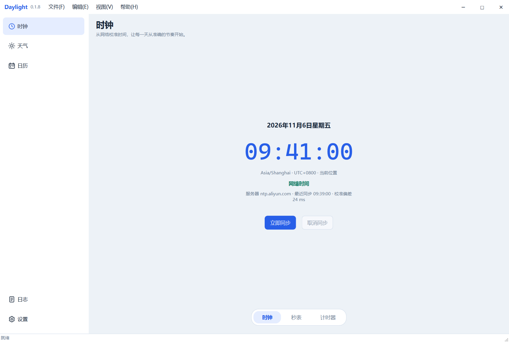
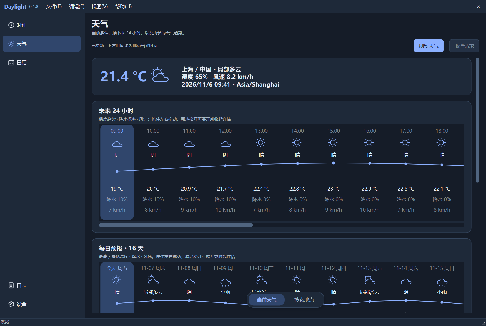
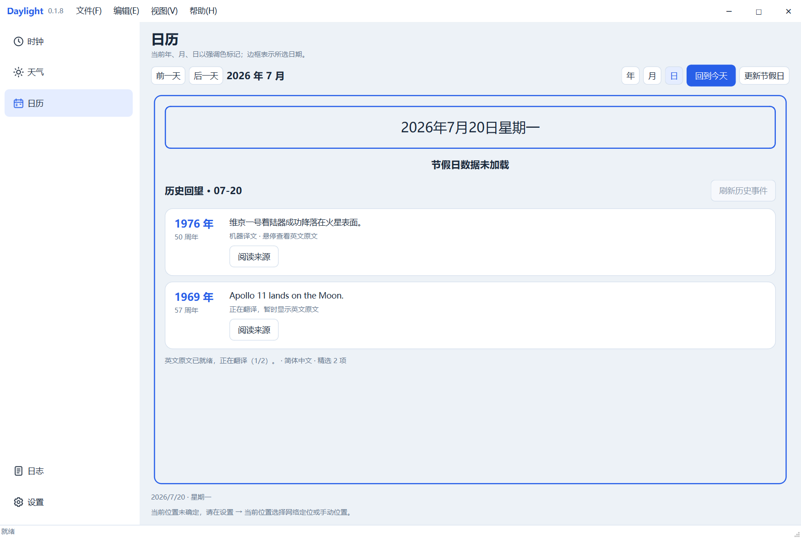
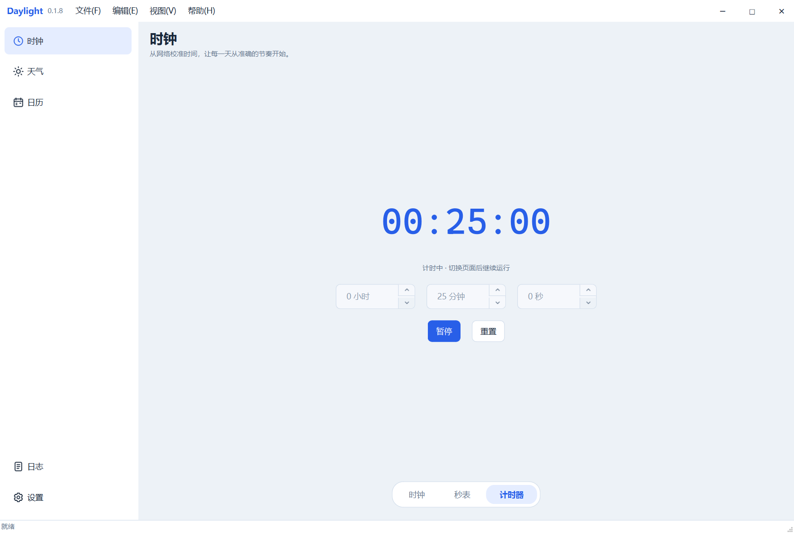
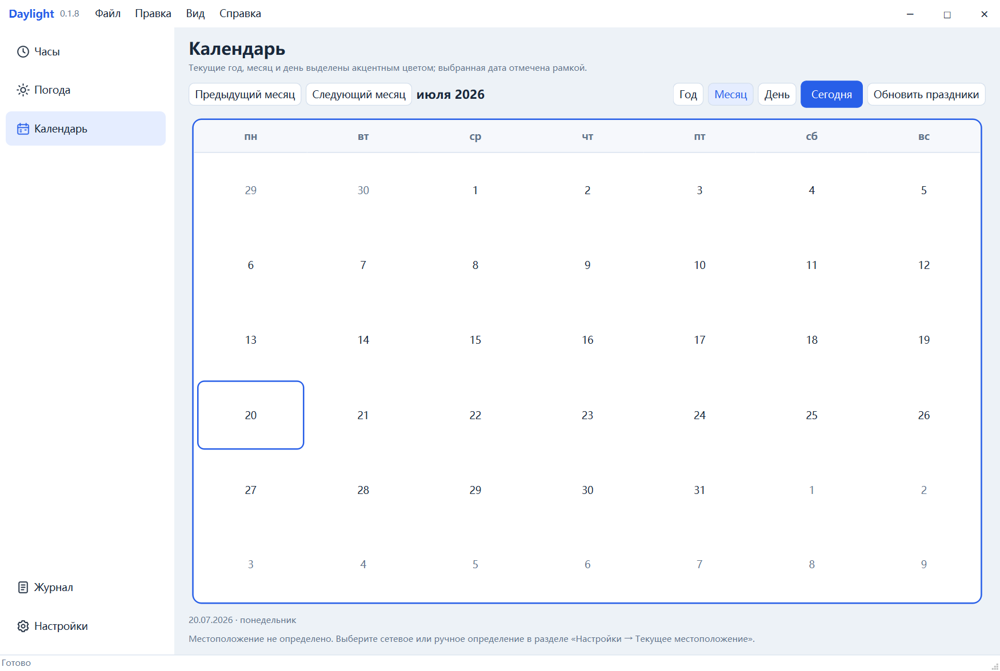

# Python Graphical Application Framework

基于 Python / PySide6 的多页面桌面应用框架，内置 **Daylight 桌面信息台**：时钟、天气、日历、日志和设置。面向 Windows、Linux 和 macOS，通过实际功能展示模块化组织、后台任务、数据缓存、主题与多语言资源管理。

## 功能概览

| 模块 | 主要能力 |
| --- | --- |
| 时钟 | 联网校时、时区显示、倒计时和秒表；切换页面后继续计时，只校准应用显示，不修改系统时间。 |
| 天气 | 当前天气使用统一位置，搜索天气独立展示其他地点；提供未来 24 小时、10–16 天预报和最近几天的历史模型数据。 |
| 日历 | 年、月、日视图与滑动切换；按当地国家展示节假日，日视图提供精选历史周年事件、翻译与后台预加载。 |
| 日志 | 实时日志、历史会话、等级筛选和自动跟随；支持查看文件、清理记录和诊断后台任务。 |
| 设置 | 注册式表单、分模块 JSON、网络或手动位置、服务切换，以及本地文件的只读弹窗预览。 |

界面共用浅色／深色主题、可伸缩侧边栏和模块内浮岛导航。软件语言支持简体中文、English、Русский及跟随系统；优先匹配对应语言，缺失时回退英文。

## 界面预览

主界面使用可伸缩侧边栏和模块内浮岛导航，时钟保持简洁的居中布局。



| 深色天气与趋势图 | 日历历史事件与逐条翻译 |
| --- | --- |
|  |  |
| **倒计时**：切换页面后继续运行 | **多语言**：俄语月历界面 |
|  |  |

截图来自真实 Qt 控件，使用临时配置和固定演示数据；天气数值与翻译进度用于展示，不代表实时 API 返回。点击图片可查看大图。重新生成：

```powershell
.venv/Scripts/python.exe scripts/capture_screenshots.py
```

截图保存在 [`docs/images/screenshots/`](docs/images/screenshots/)，脚本不读取个人配置、不发起网络请求。

## 快速运行

安装 Python 后，在仓库根目录运行：

```powershell
# Windows
python main.py
```

```bash
# Linux / macOS
python3 main.py
```

入口自动创建项目 `.venv` 并准备依赖；首次安装需要联网。IDE 解释器选择 `.venv/Scripts/python.exe`（Windows）或 `.venv/bin/python`（Linux/macOS）。依赖及版本见 [requirements.txt](requirements.txt)。

启动后，可在 **设置 → 当前位置** 选择网络定位或手动地点。当前天气、日历和时钟共用这一位置；天气搜索不改变它。API 地址、翻译服务及刷新策略在各设置分类中配置。

## 外部服务与 API

项目使用多种独立服务。下表列出默认来源和用途；具体请求由设置、缓存状态及用户操作决定。

| 用途 | 默认来源 | 接入与数据范围 |
| --- | --- | --- |
| 网络校时 | [阿里云 NTP](https://help.aliyun.com/zh/eci/user-guide/configure-the-ntp-service)，`ntp.aliyun.com:123` | 使用 SNTP／UDP，可配置服务器和端口，需要网络允许 NTP。 |
| 当前网络位置 | [ipwho.is](https://ipwhois.io/documentation) | 默认公开接口无需 Key，返回请求出口 IP 对应的大致位置与时区；代理可能改变结果。 |
| 地点搜索 | [Open-Meteo Geocoding](https://open-meteo.com/en/docs/geocoding-api) | 用于手动位置选择和独立天气搜索，返回地点名称及坐标。 |
| 天气数据 | [Open-Meteo Forecast](https://open-meteo.com/en/docs) | 默认公开接口无需 Key；预报最多 16 天，过去几天的数据为历史模型数据。 |
| 中国大陆节假日 | [holiday-cn](https://github.com/NateScarlet/holiday-cn) | 读取公开年度 JSON，包含放假与调休补班；合并次年文件以补全年末安排。 |
| 其他支持国家的节假日 | [Nager.Date](https://github.com/nager/Nager.Date) | 按国家与年份查询；当前适配器只展示全国公共假日，不包含地区专属假日。 |
| 历史上的今天 | [Wikipedia Wikifeeds](https://www.mediawiki.org/wiki/Wikifeeds#.../feed/onthisday/{type}/{mm}/{dd}) | 使用英文 `selected` 精选周年接口，按月日查询；展示年份、摘要、周年数和原文链接。 |

### 翻译服务

**设置 → 翻译**提供以下可切换适配器，每次使用所选的一家服务。公共翻译模块可供其他功能复用，当前用于历史事件正文。

| 服务 | 当前接入方式 | 配置要求 |
| --- | --- | --- |
| [MyMemory](https://mymemory.translated.net/doc/usagelimits.php)（默认） | 单段请求、有限并发 | 默认匿名调用，无需 Key；免费额度为每天 5000 字符。 |
| [Google Cloud Translation](https://docs.cloud.google.com/translate/docs/setup) | Basic v2，原生数组批量 | 启用 API 并填写 API Key。 |
| [百度通用翻译](https://fanyi-api.baidu.com/doc/21) | 签名请求、有限并发 | 填写 APP ID 和密钥。 |
| [有道文本翻译](https://ai.youdao.com/DOCSIRMA/html/trans/api/wbfy/index.html) | v3 签名请求、有限并发 | 填写应用 ID 和密钥。 |
| [LibreTranslate](https://docs.libretranslate.com/) | 原生数组批量，支持自建地址 | 是否需要 API Key 由部署决定。 |

并发请求上限可配置为 1–10，默认 10；多个日期任务共用上限。额度、可用语言与收费规则以各服务文档为准。预加载会消耗翻译额度，增加并发不会增加额度，可按需要缩小预加载范围或切换服务。

服务地址修改只适用于当前适配器支持的协议。其他协议需要新增适配器；仅更换 URL 不会自动兼容。联网任务在后台运行，失败会显示状态；翻译失败保留英文原文，已有天气和节假日数据可用于失败回退。

## 数据加载与缓存

当前天气和搜索天气分别维护数据、请求、错误及取消状态。位置更新与自动刷新只影响当前天气，搜索结果保留在搜索板块。

历史事件按**月日**查询，与所选年份或所在国家无关，默认最多显示 10 条，最近年份在上。英文原文取得后先缓存并显示；对应语言的译文完成后逐条替换。英文直接使用原文，其他语言不支持或翻译失败时回退英文。

日历默认在启动后预取今天前后各 7 天，共 15 天，每 60 分钟检查一次。范围、间隔与开关均可设置；有效完整缓存直接复用，已有原文但缺译文时只补翻译。前台进入正在预取的日期会复用请求，离开页面不取消后台预取。

原文与成功译文分别保存在 `calendar/history/MM-DD/source.json` 和 `translated.json`；节假日按国家和年份缓存。详细的有效期、请求去重与错误处理见[多页面应用落地设计](docs/多页面应用落地设计.md)。

## 配置与用户文件

程序自带默认配置位于 [assets/defaults](assets/defaults)，按 `app`、`appearance`、`clock`、`weather`、`location`、`calendar`、`translation`、`logging` 分开保存。每个文件包含 `schema_version` 和 `values`。

- 首次运行创建用户配置；以后保留已有值并补齐缺失字段，版本升级时执行模块明确注册的迁移规则。
- 设置保存成功后通知相应模块；手动编辑 JSON 后需重启，恢复默认只作用于当前分类。
- 配置、数据、缓存和日志位于 Qt 决定的用户目录，不写入安装目录。实际路径可在 **设置 → 本地文件** 查看，或点击“打开配置位置”。
- 本地文件列表支持双击只读预览；日志清空视图与删除日志文件是不同操作。
- 翻译凭据保存在本机用户 JSON 中，表单遮蔽显示，不是加密存储；请求日志不记录凭据或翻译正文。

## 开发与扩展

```text
assets/defaults/           分模块默认配置
assets/locales/            中、英、俄展示资源
src/app/                   应用装配、页面注册与窗口外壳
src/features/
  clock/                   校时、倒计时与秒表
  weather/                 当前天气、搜索天气与来源适配
  location/                统一位置及地点选择
  calendar/                日历、节假日与历史事件
  translation/             公共翻译接口及服务适配
  logs/                    实时与历史日志
  settings/                注册式表单及本地文件管理
src/shared/                任务、配置、主题、语言、网络与基础控件
tests/                     离线功能与界面测试
scripts/                   构建、清理与资源校验
version/                   应用名称与版本
docs/                      架构及界面设计说明
```

页面通过 ViewModel 和后台任务获取数据，界面不直接执行网络请求。主题、语言资源、配置保存及任务生命周期由公共基础设施提供。新增页面在 `src/app/bootstrap.py` 装配并注册；新增设置提供字段与默认 JSON；新增数据来源实现对应适配器。

### 验证与构建

准备好 `.venv` 后，使用项目解释器运行测试与资源校验。以下为 Windows 命令，Linux/macOS 将解释器路径替换为 `.venv/bin/python`：

```powershell
.venv/Scripts/python.exe -m unittest discover -s tests -v
.venv/Scripts/python.exe scripts/validate_locales.py
```

测试使用固定响应、临时用户目录和模拟接口，不代表各外部服务的实时可用性。资源校验检查重复键、英文回退覆盖、模板参数及源码静态引用。

在目标操作系统本机构建：

```bash
python scripts/build.py
python scripts/clean.py
```

Linux/macOS 可使用 `python3`。构建输出位于 `dist/`，按平台生成可执行文件或 `.app`，包含默认配置和语言资源；签名、安装器及公证不在当前脚本范围。

## 设计文档

- [应用架构设计规范](docs/应用架构设计规范.md)：模块边界、资源与配置约束。
- [多页面应用落地设计](docs/多页面应用落地设计.md)：当前服务、后台任务、缓存与翻译流程。
- [界面设计规范](docs/界面设计规范.md)：主题、导航、控件和手势约定。
- [从 Linux 式分层到应用功能模块化](docs/从Linux式分层到应用功能模块化.md)：目录与模块划分思路。
